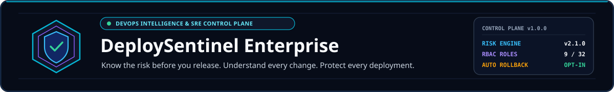
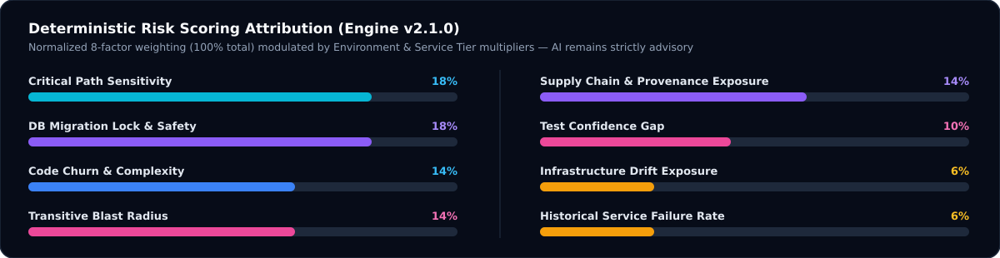
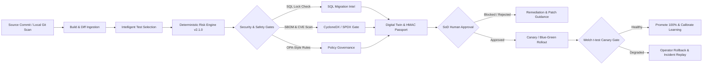
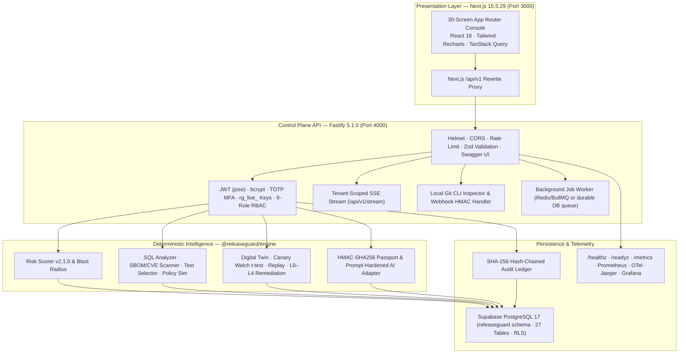
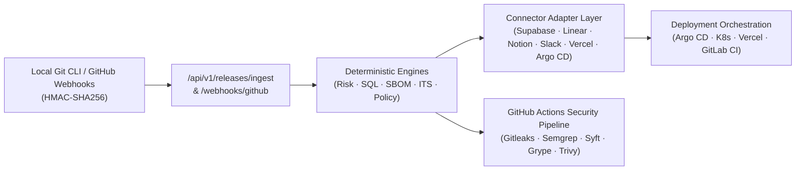
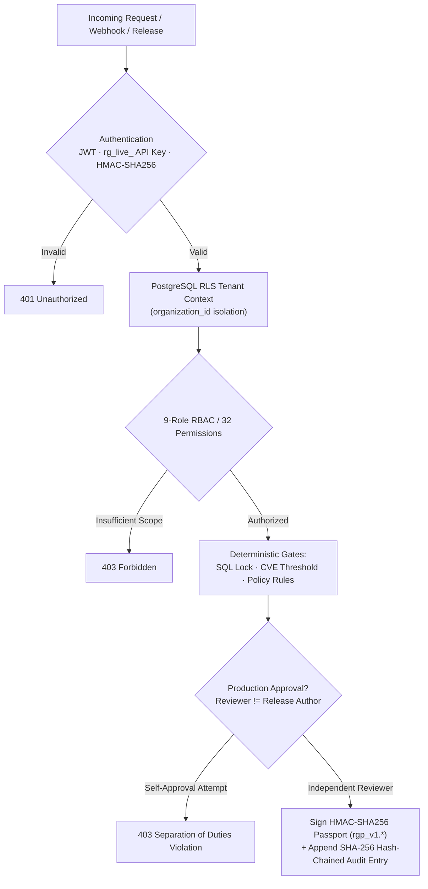
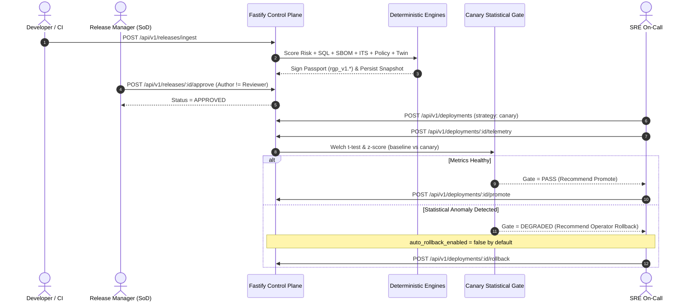
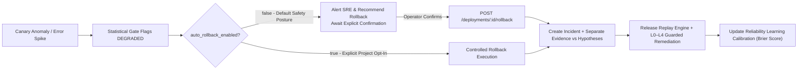

<div align="center">



<br /><br />

**Deterministic Release Risk Intelligence · Deployment Digital Twins · SQL Lock Safety · Statistical Canary Verification**

<p>
  
  = 20" />
  
  
  
  
  
</p>

<p>
  <a href="#2-project-introduction">Overview</a> •
  <a href="#5-core-capabilities">Capabilities</a> •
  <a href="#7-3d-release-lifecycle">Release Lifecycle</a> •
  <a href="#8-system-architecture">Architecture</a> •
  <a href="#9-security-architecture">Security</a> •
  <a href="#10-deployment-workflow">Deployments</a> •
  <a href="#13-installation-and-setup">Quickstart</a> •
  <a href="docs/API_SPECIFICATION.md">API Spec</a>
</p>

<br />


<br />

> **Every commit carries hidden operational risk.** ReleaseGuard Enterprise evaluates code churn, critical paths, transitive blast radius, SQL lock hazards, SBOM CVEs, infrastructure drift, and test gaps **before** a release reaches production—then guards live rollouts with Welch *t*-test statistical canary verification and human-in-the-loop controls.

</div>

<p align="center"></p>

## 1. Quick Navigation

| Section | Focus Area | Primary Artifacts |
| :--- | :--- | :--- |
| [**Product & Vision**](#2-project-introduction) | Problem solved, architecture philosophy, competitive advantage | [`PRODUCT_REQUIREMENTS.md`](docs/PRODUCT_REQUIREMENTS.md) · [`MARKET_POSITIONING.md`](docs/MARKET_POSITIONING.md) |
| [**Core Modules & Features**](#5-core-capabilities) | 16 Core Modules, 10 Differentiators, 8-factor Risk Engine `v2.1.0` | [`RISK_SCORING_MODEL.md`](docs/RISK_SCORING_MODEL.md) · [`SQL_MIGRATION_SAFETY_GUIDE.md`](docs/SQL_MIGRATION_SAFETY_GUIDE.md) |
| [**Architecture & Lifecycle**](#7-3d-release-lifecycle) | End-to-end pipeline, monorepo topology, Mermaid & 3D flows | [`ARCHITECTURE.md`](docs/ARCHITECTURE.md) · [`DATABASE_SCHEMA.md`](docs/DATABASE_SCHEMA.md) |
| [**Security & Governance**](#9-security-architecture) | 9-role RBAC (32 scopes), SoD, TOTP MFA, HMAC Passports, Hash Audit | [`SECURITY_REQUIREMENTS.md`](docs/SECURITY_REQUIREMENTS.md) · [`POLICY_AND_GOVERNANCE_GUIDE.md`](docs/POLICY_AND_GOVERNANCE_GUIDE.md) |
| [**Deployments & SRE Ops**](#10-deployment-workflow) | Canary statistical gate, L0–L4 remediation, OTel/Prometheus | [`DEPLOYMENT_AND_CANARY_GUIDE.md`](docs/DEPLOYMENT_AND_CANARY_GUIDE.md) · [`OBSERVABILITY_AND_INFRASTRUCTURE.md`](docs/OBSERVABILITY_AND_INFRASTRUCTURE.md) |
| [**Setup, API & Verification**](#13-installation-and-setup) | Local setup, `.env` reference, OpenAPI v1, Vitest & CI/CD gates | [`API_SPECIFICATION.md`](docs/API_SPECIFICATION.md) · [`PRODUCTION_READINESS_REPORT.md`](docs/PRODUCTION_READINESS_REPORT.md) |

---

## 2. Project Introduction

**ReleaseGuard Enterprise** is a unified, AI-assisted **DevOps Intelligence, Release Engineering, Deployment Risk Management, and Site Reliability Control Plane** built as a strict TypeScript npm-workspaces monorepo (`@releaseguard/shared`, `@releaseguard/engine`, `@releaseguard/api`, and `@releaseguard/web`).

Modern engineering organizations typically fragment release governance across disconnected point tools: static code scanners, database migration checklists, SBOM CVE dashboards, feature flag platforms, deployment orchestrators, incident war rooms, and post-hoc DORA spreadsheets. ReleaseGuard unifies the entire pre-release, rollout, and post-deployment reliability loop into one cryptographically auditable control plane backed by **PostgreSQL 17 Row-Level Security (RLS)** and **30 App Router console screens**.

---

## 3. Product Vision

ReleaseGuard is engineered around four non-negotiable architectural invariants:

| Architectural Principle | Implementation Guarantee |
| :--- | :--- |
| **Deterministic Engines First** | All risk scoring (`v2.1.0`), SQL lock hazard detection, CVE threshold checks, policy gates, and Welch *t*-test canary math execute in pure, reproducible TypeScript engines (`packages/engine`). AI synthesis is strictly advisory and never holds sole approval authority. |
| **Human-in-the-Loop Safety** | `auto_rollback_enabled` defaults to `false` across every project and environment. Canary anomalies trigger recommendations and await explicit operator confirmation. Production chaos fault injection is blocked by default (`prod_blocked = true`). |
| **Cryptographic Accountability** | Every evaluated release receives an HMAC-SHA256 **Deployment Readiness Passport** (`rgp_v1.*`), every approval enforces **Separation of Duties (SoD)**, and every administrative/operational action is appended to a **SHA-256 hash-chained audit log**. |
| **Ethical Engineering Telemetry** | DORA metrics (Deployment Frequency, Lead Time, Change Failure Rate, MTTR) are aggregated strictly at **project and organization scopes**. Individual developer ranking or surveillance scoring is prohibited by design. |

---

## 4. Why ReleaseGuard Enterprise?

| Capability Dimension | Traditional Point Tools | ReleaseGuard Enterprise |
| :--- | :--- | :--- |
| **Pre-Release Risk Intelligence** | Post-hoc deployment failure reporting | Deterministic 8-dimension scoring (`v2.1.0`) + Blast Radius before merge/deploy |
| **Database Migration Safety** | Manual DBA PR review or late runtime locks | AST/DDL hazard scanner (`DROP`, `TRUNCATE`, table rewrites, missing `CONCURRENTLY`) + Expand-and-Contract plan |
| **Supply Chain & Provenance** | Siloed dependency CVE alerts | CycloneDX 1.5 / SPDX 2.3 inventory + CVE/license gates + SLSA provenance verification |
| **Policy Evolution** | Hard production cutovers that surprise teams | **Policy Simulation Mode** dry-runs candidate rules against historical releases |
| **Canary & Rollback Control** | Static thresholds or opaque auto-triggers | Statistical Welch *t*-test / z-score gate + explicit human-in-the-loop rollback |
| **Incident & Learning Loop** | Disconnected chat timelines | Synchronized **Release Replay Engine** + Observed Evidence vs Ranked Causal Hypotheses + Brier score calibration |
| **Developer Metrics** | Per-committer leaderboards | **Ethical DORA** strictly scoped to projects and organizations |

<p align="center"></p>

## 5. Core Capabilities

ReleaseGuard delivers **16 Core Product Modules** paired with **10 Enterprise Differentiators**, all backed by persistent PostgreSQL tables in the `releaseguard` schema and exposed through `/api/v1` and the 30-screen Web Console.

<table>
  <tr>
    <td width="50%" valign="top">
      <h3>16 Core Product Modules</h3>
      <ul>
        <li><strong>Multi-Tenant RBAC:</strong> 9 roles, 32 granular permissions, PostgreSQL RLS</li>
        <li><strong>Deterministic Risk Engine (<code>v2.1.0</code>):</strong> 8 weighted risk signals + attribution</li>
        <li><strong>Change Impact Analysis:</strong> File-to-module criticality mapping</li>
        <li><strong>Intelligent Test Selection:</strong> Risk-weighted suite reduction &amp; mandatory security gates</li>
        <li><strong>Supply Chain Security:</strong> CycloneDX 1.5 / SPDX 2.3 SBOM &amp; CVE scanning</li>
        <li><strong>SQL Migration Intelligence:</strong> Lock tier analysis &amp; Expand-Contract synthesis</li>
        <li><strong>Deployment Control Center:</strong> Canary, Blue/Green, and Rolling orchestrations</li>
        <li><strong>Canary Statistical Gate:</strong> Welch <em>t</em>-test &amp; z-score telemetry evaluation</li>
        <li><strong>Post-Deploy Health Telemetry:</strong> Error rate, p95 latency, CPU saturation tracking</li>
        <li><strong>Incident Investigation:</strong> Evidence-separated root-cause hypotheses &amp; postmortems</li>
        <li><strong>Controlled Remediation (L0–L4):</strong> Guarded, reversible, human-approved runbooks</li>
        <li><strong>Release Governance:</strong> Declarative Policy-as-Code rules &amp; SoD approvals</li>
        <li><strong>Infrastructure Drift Intel:</strong> Terraform/K8s drift detection &amp; PR patch diffing</li>
        <li><strong>Cloud FinOps Deltas:</strong> Manifest-based monthly replica/vCPU/RAM/storage cost delta</li>
        <li><strong>Ethical DORA Metrics:</strong> Team &amp; org velocity/stability without individual ranking</li>
        <li><strong>Compliance &amp; Audit Center:</strong> SOC 2, ISO 27001, NIST, OWASP, SLSA, GDPR + SHA-256 chain</li>
      </ul>
    </td>
    <td width="50%" valign="top">
      <h3>10 Enterprise Differentiators</h3>
      <ul>
        <li><strong>Deployment Digital Twin:</strong> Pre-rollout behavioral snapshot predicting traffic splits, p95 latency delta, lock tier, and policy gate outcomes</li>
        <li><strong>Release Blast-Radius Simulator:</strong> Transitive closure across downstream services, API contracts, and datastores</li>
        <li><strong>Release Replay Engine:</strong> Synchronized chronological timeline from commit &rarr; scoring &rarr; SQL &rarr; SBOM &rarr; policy &rarr; deploy &rarr; incident &rarr; remediation</li>
        <li><strong>Reliability Learning Engine:</strong> Continuous outcome feedback tracking Precision, Recall, F1, and Brier Score</li>
        <li><strong>Deployment Readiness Passport:</strong> Tamper-evident HMAC-SHA256 signed artifact (<code>rgp_v1.*</code>) certifying release readiness</li>
        <li><strong>Autonomous Incident Investigation:</strong> Prompt-injection-hardened synthesis separating observed telemetry from causal hypotheses</li>
        <li><strong>Predictive Reliability Calibration:</strong> Confidence interval calibration against historical production incidents</li>
        <li><strong>Chaos Engineering Readiness:</strong> Resilience gap scoring &amp; non-production experiment templates (prod blocked)</li>
        <li><strong>Policy Simulation Mode:</strong> Historical dry-run impact analysis prior to enforcing stricter rules</li>
        <li><strong>Cross-Project Reliability Intel:</strong> Org-wide risk benchmarking and shared directory hotspot detection</li>
      </ul>
    </td>
  </tr>
</table>

---

## 6. Key Features

### Deterministic 8-Dimension Risk Scoring (`v2.1.0`)

Every release ingested via the Web Console, REST API, Local Git Scanner, or HMAC-signed webhook passes through `computeDeterministicRiskScore()` (`packages/engine/src/risk-scorer.ts`). Raw normalized signals are weighted across **8 deterministic dimensions** and modulated by Environment (`dev` `0.85x`, `staging` `1.0x`, `prod` `1.12x`) and Service Tier (`TIER_0` `1.1x`, `TIER_1` `1.0x`, `TIER_2/3` `0.9x`).

<p align="center">
  
</p>

### SQL Migration Lock Safety & Expand-and-Contract Synthesis
- Detects blocking PostgreSQL hazards in DDL/DML scripts: `DROP TABLE`, `DROP COLUMN`, `TRUNCATE`, `ALTER COLUMN TYPE` table rewrites, `NOT NULL` constraints without `DEFAULT`, and `CREATE INDEX` without `CONCURRENTLY`.
- Automatically produces a **4-step Expand-and-Contract migration plan** and best-effort rollback SQL, while gating `HIGH`/`CRITICAL` migrations behind explicit DBA or `SECURITY_ADMIN` approval.

### Real Local Git Repository Scanner
- Built directly into `@releaseguard/api` (`apps/api/src/services/git-inspector.ts`) and accessible via `/projects` or `POST /api/v1/projects/scan-local-repo`.
- Executes safe `git rev-parse`, `git diff`, `package.json`, and `*.sql` inspections on a target workspace path and feeds real commit/file/dependency diffs directly into the scoring pipeline.

### Prompt-Injection-Hardened AI Adapter
- Defaults to `AI_PROVIDER=local` for zero-dependency deterministic explanations (`packages/engine/src/ai-adapter.ts`), with optional OpenAI, Anthropic, and Ollama adapters.
- Strips instruction-override patterns from untrusted commit messages, PR descriptions, and SQL comments so AI commentary can never alter deterministic risk scores or policy gates.

<p align="center"></p>

## 7. 3D Release Lifecycle

From source commit to statistical canary verification and guarded remediation, every release traverses an observable, deterministic pipeline:

<p align="center">
  
</p>

### Release Lifecycle Flow



<p align="center"></p>

## 8. System Architecture

ReleaseGuard is structured as a modular **4-workspace TypeScript monorepo** engineered for strict separation between pure domain engines (`@releaseguard/engine`), shared contracts (`@releaseguard/shared`), API orchestration (`@releaseguard/api`), and the App Router console (`@releaseguard/web`).

<p align="center">
  
</p>

### High-Level System Architecture



### CI/CD & External Integration Architecture



<p align="center"></p>

## 9. Security Architecture

Security in ReleaseGuard is enforced across identity, tenant isolation, cryptographic attestation, and supply-chain verification.

<p align="center">
  
</p>

### Security Validation Workflow



### 9-Role RBAC & Guardrail Matrix

| Role | Access Scope | Key Operational Permissions & Boundaries |
| :--- | :--- | :--- |
| **`ORG_OWNER`** | Full Tenant Authority | Organization settings, billing plans, member roles, API keys, policies, and production approvals |
| **`PLATFORM_ADMIN`** | Infrastructure & Control | Manage projects, environments, integrations, policies, and deployments |
| **`SECURITY_ADMIN`** | AppSec & Governance | Manage SBOMs, CVE gates, SQL migration approvals, drift PRs, and compliance evidence exports |
| **`RELEASE_MANAGER`** | Release Gatekeeper | Approve/reject production releases (subject to SoD), trigger promotions and rollbacks |
| **`SRE_ONCALL`** | Live Reliability | Monitor canary statistical gates, investigate/resolve incidents, propose/approve/execute L0–L4 remediations |
| **`DEV_LEAD`** | Team Delivery Lead | Create projects, ingest releases, approve non-prod releases, run policy simulations, deploy non-prod |
| **`DEVELOPER`** | Engineering Contributor | Ingest releases, inspect Digital Twin & Blast Radius, run SQL/SBOM sandboxes, propose fixes |
| **`AUDITOR`** | Compliance Read-Only | Inspect releases, compliance controls, export evidence bundles, verify SHA-256 audit chain |
| **`VIEWER`** | Standard Read-Only | View dashboards, Ethical DORA metrics, releases, and incident timelines |

### Core Security Controls
- **Tenant Isolation:** 27 tables isolated inside PostgreSQL `releaseguard` schema (`supabase/migrations/20261116000001_releaseguard_schema.sql`) with Row-Level Security policies.
- **MFA & API Keys:** RFC 6238 TOTP MFA (`otpauth`) and hashed `rg_live_` CI/CD keys with per-org scoping.
- **Tamper-Evident Audit Chain:** Every sensitive mutation computes `SHA-256(prev_hash || payload)` verifiable via `GET /api/v1/audit-logs/verify`.
- **Patched Web Runtime:** Runs Next.js `15.5.29` (eliminating CVE-2025-66478) with Helmet security headers, Zod input validation, and Fastify rate limiting (`300 req/min`).

<p align="center"></p>

## 10. Deployment Workflow

ReleaseGuard enforces clean progressive isolation across **Development**, **Testing**, **Canary Staging**, and **Production** environments—keeping humans in control of every production promotion and rollback.

<p align="center">
  
</p>

### Deployment Sequence



### Failure Handling & Human-in-the-Loop Rollback



<p align="center"></p>

## 11. Technology Stack

All versions below are verified directly from workspace `package.json`, `infra/`, and `.github/workflows/ci-security.yml` manifests:

| Layer | Technologies & Verified Versions |
| :--- | :--- |
| **Frontend Console** | Next.js `15.5.29` (App Router, 30 screens), React `18.3.1`, TypeScript `5.6.3`, Tailwind CSS `3.4.15`, TanStack React Query `5.60.5`, Recharts `2.13.3`, Lucide Icons `0.460.0` |
| **Control Plane API** | Fastify `5.1.0`, `@fastify/helmet` `13.0.1`, `@fastify/cors` `10.0.1`, `@fastify/rate-limit` `10.2.0`, `@fastify/swagger` `9.4.0`, `@fastify/swagger-ui` `5.2.0`, `jose` `5.9.6`, `bcryptjs` `2.4.3`, `otpauth` `9.3.5`, `zod` `3.23.8`, `ws` `8.23.0` |
| **Deterministic Engines** | `@releaseguard/engine` (`1.0.0`), `@releaseguard/shared` (`1.0.0`), Vitest `2.1.4` |
| **Database & Queue** | Supabase PostgreSQL `17` (`releaseguard` schema, 27 tables, RLS), `@supabase/supabase-js` `2.46.1`, durable DB queue (`releaseguard.jobs_queue`) with optional Redis `7` |
| **Containers, IaC & Obs** | Multi-stage Alpine Dockerfiles (`Dockerfile.api`, `Dockerfile.web`), Docker Compose, Kubernetes `Deployment`, Terraform (AWS KMS + S3 archive), Prometheus, OpenTelemetry Collector, Jaeger, Grafana |
| **CI/CD & Security** | GitHub Actions (`ci-security.yml`), Gitleaks, Semgrep (`p/typescript`, `p/owasp-top-ten`), Syft (CycloneDX JSON), Grype, Trivy |

---

## 12. Repository Structure

```text
releaseguard/
├── .github/workflows/
│   └── ci-security.yml                 # Typecheck, build, Vitest, Gitleaks, Semgrep, Syft, Grype, Trivy
├── apps/
│   ├── api/                            # @releaseguard/api — Fastify REST v1, Swagger, SSE, Git CLI scanner
│   │   ├── src/auth/                   # JWT, bcrypt, TOTP MFA, rg_live_ API keys, 9-role RBAC
│   │   ├── src/db/                     # Supabase client (releaseguard schema) & idempotent seed
│   │   ├── src/routes/                 # auth, releases, governance, ops route modules
│   │   ├── src/services/               # sse, git-inspector, connectors, job-worker
│   │   └── src/__tests__/              # Live PostgreSQL 17 integration & security test suites (6/6)
│   └── web/                            # @releaseguard/web — 30-screen Next.js 15.5.29 Enterprise Console
│       ├── next.config.mjs             # /api/v1/:path* reverse-proxy rewrite to Fastify API
│       └── src/                        # App Router pages, Providers, AppShell, RiskBadge, API client
├── packages/
│   ├── shared/                         # @releaseguard/shared — 9 roles, 32 permissions, SaaS plans, types
│   └── engine/                         # @releaseguard/engine — 11 deterministic intelligence modules + tests (10/10)
├── infra/
│   ├── Dockerfile.api & Dockerfile.web # Non-root multi-stage Alpine container builds
│   ├── docker-compose.yml              # Full stack: API, Web, Redis, Prometheus, OTel, Jaeger, Grafana
│   ├── k8s/deployment.yaml             # Non-root Kubernetes manifests with /healthz & /readyz probes
│   ├── observability/                  # prometheus.yml & otel-collector.yaml
│   └── terraform/main.tf               # AWS KMS key + encrypted S3 SBOM/audit archive
├── supabase/migrations/
│   └── 20261116000001_releaseguard_schema.sql  # 27 tables, indexes, RLS policies, PostgREST schema grants
├── docs/
│   ├── assets/readme/                  # Original 3D WebP artwork & vector SVGs for README showcase
│   └── *.md                            # 19 architecture, security, API, guide, and readiness documents
├── .env.example                        # Environment configuration template
├── IMPLEMENTATION_STATUS.md            # Phase 0–20 completion & verification log
└── package.json                        # Root npm workspace scripts (Node >= 20)
```

<p align="center"></p>

## 13. Installation and Setup

### Prerequisites
- **Node.js `>= 20.0.0`** and **npm**
- A **Supabase PostgreSQL** project with the `releaseguard` schema migration applied (`supabase/migrations/20261116000001_releaseguard_schema.sql`) and `releaseguard` exposed in PostgREST schemas

### Local Quickstart

```bash
# 1. Configure environment variables
cp .env.example .env
# Edit .env with your Supabase URL/keys and 64-char hex signing secrets

# 2. Install monorepo dependencies
npm install

# 3. Typecheck and build all 4 workspaces (@releaseguard/shared, engine, api, web)
npm run typecheck
npm run build

# 4. Seed multi-tenant demo organizations, users, policies, and sample releases
npm run seed

# 5. Start the Fastify API (0.0.0.0:4000) and Next.js Web Console (0.0.0.0:3000)
npm run dev:api
npm run dev:web
```

### Seeded Demo Accounts (Password: `ReleaseGuard!2026`)

| Email | RBAC Role | Tenant Organization | Ideal Walkthrough Focus |
| :--- | :--- | :--- | :--- |
| `owner@acme.releaseguard.io` | `ORG_OWNER` | Acme Cloud Corp | Full admin, TOTP MFA, `rg_live_` API keys, plan metering, approvals |
| `relmgr@acme.releaseguard.io` | `RELEASE_MANAGER` | Acme Cloud Corp | Production release gate & Separation of Duties approval |
| `sre@acme.releaseguard.io` | `SRE_ONCALL` | Acme Cloud Corp | Deployments, Canary statistical gate, Incidents & L0–L4 remediation |
| `sec@acme.releaseguard.io` | `SECURITY_ADMIN` | Acme Cloud Corp | SBOM/CVEs, SQL migration approvals, policy rules & compliance export |
| `dev@acme.releaseguard.io` | `DEVELOPER` | Acme Cloud Corp | Release ingestion, Local Git scan, Digital Twin & sandboxes |
| `auditor@acme.releaseguard.io` | `AUDITOR` | Acme Cloud Corp | Read-only compliance frameworks & SHA-256 audit chain verification |
| `beta-owner@beta.releaseguard.io` | `ORG_OWNER` | Beta Fintech Labs | Multi-tenant PostgreSQL RLS isolation verification |

<details>
<summary><strong>Docker Compose Full-Stack Deployment (API + Web + Redis + Prometheus + OTel + Jaeger + Grafana)</strong></summary>

```bash
docker compose -f infra/docker-compose.yml up --build
```

Services defined in `infra/docker-compose.yml`:
- **API (`4000`)**, **Web (`3000`)**, **Redis 7 (`6379`)**, **Prometheus (`9090`)**, **OTel Collector (`4317`/`4318`)**, **Jaeger (`16686`)**, **Grafana (`3001`)**.

</details>

---

## 14. Configuration

Environment variables defined in `.env.example`:

| Variable | Default / Example | Purpose |
| :--- | :--- | :--- |
| `NODE_ENV` | `development` | Runtime mode (`development`, `test`, `production`) |
| `HOST` / `PORT` | `0.0.0.0` / `4000` | Fastify API bind host and listening port |
| `WEB_URL` | `http://localhost:3000` | Web console origin URL |
| `NEXT_PUBLIC_API_URL` | `/api/v1` | Relative browser API prefix proxied via `apps/web/next.config.mjs` |
| `SUPABASE_URL` | `https://<ref>.supabase.co` | Supabase project REST endpoint |
| `SUPABASE_ANON_KEY` | `<anon-key>` | Supabase anonymous key |
| `SUPABASE_SERVICE_ROLE_KEY` | `<service-role-key>` | Service role key used by API control plane |
| `SUPABASE_DB_SCHEMA` | `releaseguard` | Isolated PostgreSQL schema containing all 27 tables |
| `JWT_SECRET` | `64-char hex` | HMAC secret for signing session JWT tokens |
| `PASSPORT_SIGNING_SECRET` | `64-char hex` | Secret for signing `rgp_v1.*` Deployment Readiness Passports |
| `WEBHOOK_SIGNING_SECRET` | `64-char hex` | HMAC-SHA256 verification secret for `/api/v1/webhooks/github` |
| `ENCRYPTION_KEY` | `64-char hex` | 32-byte key for encrypting integration secrets/tokens |
| `REDIS_URL` | *(empty = DB queue)* | Optional Redis/BullMQ URL; falls back to `releaseguard.jobs_queue` |
| `AI_PROVIDER` | `local` | `local` (deterministic zero-key explainer), `openai`, `anthropic`, or `ollama` |
| `OPENAI_API_KEY` / `ANTHROPIC_API_KEY` | *(optional)* | Optional external LLM keys when `AI_PROVIDER` != `local` |
| `LINEAR_API_KEY` / `VERCEL_TOKEN` / `GITHUB_TOKEN` / `SLACK_WEBHOOK_URL` | *(optional)* | Optional connector credentials for `/integrations` |

---

## 15. API Documentation

- **Interactive Swagger UI:** `http://localhost:4000/api/v1/docs` (or `/api/v1/docs` via Next.js proxy)
- **OpenAPI 3.x JSON Schema:** `/api/v1/docs/json`
- **Complete Endpoint Inventory:** [`docs/API_SPECIFICATION.md`](docs/API_SPECIFICATION.md)

| Domain | Key REST v1 Endpoints |
| :--- | :--- |
| **Auth & RBAC** | `POST /api/v1/auth/register`, `POST /api/v1/auth/login`, `GET /api/v1/auth/me`, `POST /api/v1/auth/mfa/setup`, `GET\|POST\|DELETE /api/v1/auth/api-keys`, `GET\|PATCH /api/v1/org/members` |
| **Projects & Releases** | `GET\|POST /api/v1/projects`, `POST /api/v1/projects/scan-local-repo`, `POST /api/v1/releases/ingest`, `POST /api/v1/webhooks/github`, `POST /api/v1/releases/:id/approve`, `POST /api/v1/releases/:id/explain`, `GET /api/v1/releases/:id/replay` |
| **Verification Gates** | `GET\|POST /api/v1/sql-migrations` (`/analyze`, `/:id/approve`), `GET\|POST /api/v1/sboms` (`/analyze`), `GET /api/v1/test-selections`, `GET\|POST /api/v1/policies`, `POST /api/v1/policies/simulate` |
| **Deployments & Ops** | `GET\|POST /api/v1/deployments` (`/:id/telemetry`, `/:id/promote`, `/:id/rollback`), `GET\|POST /api/v1/incidents` (`/:id/resolve`), `GET\|POST /api/v1/remediations` (`/:id/approve`, `/:id/execute`), `GET /api/v1/stream` (SSE) |
| **Insights & Governance** | `GET\|POST /api/v1/drifts`, `GET\|POST /api/v1/finops`, `GET /api/v1/dora`, `GET /api/v1/learning/calibration`, `GET\|POST /api/v1/chaos`, `GET /api/v1/cross-project`, `GET /api/v1/compliance` (`/export`), `GET /api/v1/audit-logs/verify` |

---

## 16. Testing and Quality Assurance

Run the full workspace verification suite from the repository root:

```bash
npm run typecheck   # Strict TypeScript across shared, engine, api, and web
npm run build       # Compiles all 4 packages + 32 Next.js routes
npm test            # Runs @releaseguard/engine (10/10) + @releaseguard/api (6/6)
```

| Verification Suite | Scope | Verified Result |
| :--- | :--- | :--- |
| **`@releaseguard/engine` Unit Tests** | Risk scorer `v2.1.0`, Blast Radius, ITS, SQL lock analyzer, SBOM/CVE scanner, Policy Simulation, Canary Welch *t*-test, Replay, Drift/FinOps/DORA, Prompt-Injection & Passport HMAC | **10 / 10 PASSED** |
| **`@releaseguard/api` Integration Tests** | Live Supabase PG17 tenant isolation (`Acme` vs `Beta`), 9-role RBAC & SoD `403` enforcement, idempotent ingestion, Local Git CLI scan, Webhook HMAC verification, SHA-256 audit chain integrity | **6 / 6 PASSED** |
| **CI Security Pipeline** | `.github/workflows/ci-security.yml`: Gitleaks secrets scan, Semgrep (`p/typescript`, `p/owasp-top-ten`), Syft CycloneDX SBOM, Grype critical CVE gate, Trivy filesystem scan | **Configured in CI** |

<p align="center"></p>

## 17. Observability

ReleaseGuard combines live SRE telemetry endpoints with OpenTelemetry, Prometheus, Jaeger, and Grafana configurations (`infra/observability/`):

<p align="center">
  
</p>

| Telemetry Surface | Endpoint / Config | What It Provides |
| :--- | :--- | :--- |
| **Process Liveness** | `GET /healthz` | API service liveness status and timestamp |
| **Database Readiness** | `GET /readyz` | Live connectivity check against Supabase PostgreSQL 17 (`releaseguard` schema) |
| **Prometheus Metrics** | `GET /metrics` | `releaseguard_releases_total`, `releaseguard_open_incidents_total`, `releaseguard_up` |
| **Live Event Stream** | `GET /api/v1/stream` | Tenant-scoped Server-Sent Events (SSE) for real-time console updates |
| **OTel + Jaeger + Grafana** | `infra/observability/` | `otel-collector.yaml` (`4317`/`4318`) & `prometheus.yml` scrape configs |

---

## 18. Web Console Screens & Demonstrations

All **30 App Router screens** in `@releaseguard/web` are implemented, compiled (`next build`), and verified against the live API proxy. *(Static UI browser screenshots are not bundled in `docs/`; start the local server with `npm run dev:api` and `npm run dev:web` and use the one-click RBAC personas at `/login` to explore every screen interactively.)*

<details>
<summary><strong>Explore All 30 Verified Next.js Web Console Routes</strong></summary>

| Group | Route | Screen Name | Core Capability |
| :--- | :--- | :--- | :--- |
| **Public & Auth** | `/` · `/pricing` | Landing & Commercial Tiers | Platform overview & `FREE`/`STARTER`/`PROFESSIONAL`/`ENTERPRISE` plans |
| | `/login` · `/register` | Auth & Tenant Onboarding | Email/password + TOTP MFA + 1-click RBAC personas + RLS org creation |
| **Pre-Release** | `/dashboard` | Executive & SRE Overview | Org KPIs, risk trajectory chart, active incidents, canary gate summary |
| | `/projects` | Projects & Git Scanner | Register services, inspect environments, scan local Git repositories |
| | `/releases` | Release Intelligence | Filterable release ledger & manual/CI ingestion |
| | `/releases/[id]` | Release Detail & Passport | 8-factor attribution, AI Explainer, SoD approval, HMAC Passport (`rgp_v1.*`) |
| | `/digital-twin` | Deployment Digital Twin | Baseline/canary split, predicted p95 latency delta & lock forecast |
| | `/blast-radius` | Blast-Radius Simulator | Transitive service, API contract, and datastore dependency impact |
| **Verification** | `/sql-migrations` | SQL Migration Intel | Interactive SQL DDL sandbox, Expand-Contract plan & DBA approval |
| | `/supply-chain` | SBOM & Supply Chain | CycloneDX 1.5 / SPDX 2.3 inventory, CVE matching & SLSA status |
| | `/test-selection` | Intelligent Test Select | Risk-weighted suite reduction & mandatory security/migration gates |
| | `/governance` | Policy Governance | Declarative Policy-as-Code rules & environment enforcement |
| | `/policy-simulation` | Policy Simulation Mode | Historical dry-run impact analysis before rule enforcement |
| **Delivery & SRE** | `/deployments` | Deployment Control Center | Canary, blue/green & rolling triggers; promote or operator rollback |
| | `/canary` | Canary Intelligence | Baseline vs canary comparison & Welch *t*-test statistical gate |
| | `/health` | Post-Deploy Health | Error rate, p95 latency & CPU saturation telemetry |
| | `/incidents` | Incident Investigation | Observed telemetry evidence vs ranked causal hypotheses & postmortems |
| | `/replay` | Release Replay Engine | Synchronized commit-to-remediation chronological timeline |
| | `/remediation` | Remediation (L0–L4) | Autonomy-tagged, reversible, human-approved remediation actions |
| **Insights & Admin** | `/drift` · `/finops` | Infra Drift & Cloud FinOps | Terraform/K8s drift PR diffs & manifest monthly cost delta estimates |
| | `/dora` · `/learning` | Ethical DORA & Learning | Team/org DORA trends (no dev ranking) + Precision/Recall/F1/Brier score |
| | `/chaos` · `/cross-project` | Chaos & Cross-Project | Resilience gaps (prod blocked) & shared hotspot benchmarking |
| | `/compliance` · `/integrations` · `/settings` | Compliance, Connectors & Org | SOC 2/ISO/NIST/OWASP/SLSA/GDPR, SHA-256 verify, TOTP MFA, `rg_live_` keys |

</details>

---

## 19. Roadmap & Implementation Status

All 20 implementation phases (`0` through `20`) documented in [`IMPLEMENTATION_STATUS.md`](IMPLEMENTATION_STATUS.md) and [`docs/PRODUCTION_READINESS_REPORT.md`](docs/PRODUCTION_READINESS_REPORT.md) are **COMPLETED** and verified.

| Area | Current Verified Status | Notes & Future Hardening Path |
| :--- | :--- | :--- |
| **Core Platform & 30-Screen Console** | Completed & Verified | 4 npm workspaces, 27 Supabase PG17 tables, 16/16 automated tests passing |
| **AI Explanation Engine** | Deterministic `local` default | Optional OpenAI / Anthropic / Ollama providers configurable via `AI_PROVIDER` |
| **Background Queue** | Durable DB queue (`jobs_queue`) | Automatically upgrades to BullMQ/Redis when `REDIS_URL` is configured |
| **Commercial Metering** | `SANDBOX_METERING_ADAPTER` | Explicit sandbox adapter in place; ready to swap for live Stripe billing webhooks |
| **External Connectors** | Adapter layer + Local Git CLI | Live Supabase, Linear, Notion, Vercel & Local Git CLI active; external GitHub/Slack webhooks ready for token binding |

---

## 20. Contribution Guidelines

1. **Preserve Safety & Determinism Invariants:** Never allow AI outputs to mutate deterministic risk scores or bypass Policy/SoD gates, and preserve `auto_rollback_enabled = false` defaults.
2. **Keep Workspace Boundaries Clean:** Pure domain logic belongs in `packages/engine` with deterministic Vitest unit coverage; shared contracts belong in `packages/shared`; route handlers and persistence belong in `apps/api`.
3. **Run Full Verification Before Opening a PR:**
   ```bash
   npm run typecheck && npm run build && npm test
   ```
4. **Update Documentation:** Keep `docs/` specifications synchronized with any schema, RBAC, or REST `/api/v1` contract changes.

---

## 21. License

This repository is marked `"private": true` in `package.json` (**ReleaseGuard Enterprise Private Monorepo**). No standalone open-source `LICENSE` file is bundled in this repository; please contact the repository owner for commercial or enterprise licensing terms.

---

## 22. Final Project Showcase & Documentation Library

Explore the complete engineering specification suite in [`docs/`](docs/):

| Architecture & Product | Security & Governance | Operations & Readiness |
| :--- | :--- | :--- |
| [`PRODUCT_REQUIREMENTS.md`](docs/PRODUCT_REQUIREMENTS.md) | [`SECURITY_REQUIREMENTS.md`](docs/SECURITY_REQUIREMENTS.md) | [`DEPLOYMENT_AND_CANARY_GUIDE.md`](docs/DEPLOYMENT_AND_CANARY_GUIDE.md) |
| [`ARCHITECTURE.md`](docs/ARCHITECTURE.md) | [`POLICY_AND_GOVERNANCE_GUIDE.md`](docs/POLICY_AND_GOVERNANCE_GUIDE.md) | [`INCIDENT_REPLAY_AND_REMEDIATION.md`](docs/INCIDENT_REPLAY_AND_REMEDIATION.md) |
| [`DATABASE_SCHEMA.md`](docs/DATABASE_SCHEMA.md) | [`SQL_MIGRATION_SAFETY_GUIDE.md`](docs/SQL_MIGRATION_SAFETY_GUIDE.md) | [`OBSERVABILITY_AND_INFRASTRUCTURE.md`](docs/OBSERVABILITY_AND_INFRASTRUCTURE.md) |
| [`API_SPECIFICATION.md`](docs/API_SPECIFICATION.md) | [`SUPPLY_CHAIN_SECURITY.md`](docs/SUPPLY_CHAIN_SECURITY.md) | [`COMPLIANCE_AND_ETHICAL_DORA.md`](docs/COMPLIANCE_AND_ETHICAL_DORA.md) |
| [`RISK_SCORING_MODEL.md`](docs/RISK_SCORING_MODEL.md) | [`COMPETITIVE_ANALYSIS.md`](docs/COMPETITIVE_ANALYSIS.md) | [`PRODUCTION_READINESS_REPORT.md`](docs/PRODUCTION_READINESS_REPORT.md) |
| [`MARKET_POSITIONING.md`](docs/MARKET_POSITIONING.md) | [`CONNECTOR_RESPONSIBILITY_MATRIX.md`](docs/CONNECTOR_RESPONSIBILITY_MATRIX.md) | [`CONNECTOR_UTILIZATION_REPORT.md`](docs/CONNECTOR_UTILIZATION_REPORT.md) |

<p align="center">
  
  <br />
  <strong>ReleaseGuard Enterprise</strong> — <em>Know the risk before you release. Understand every change. Protect every deployment.</em>
  <br /><br />
  <a href="#1-quick-navigation">Back to Top ↑</a>
</p>
