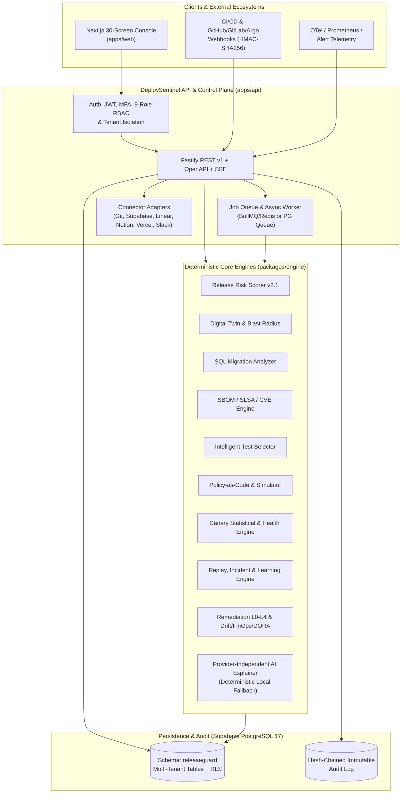
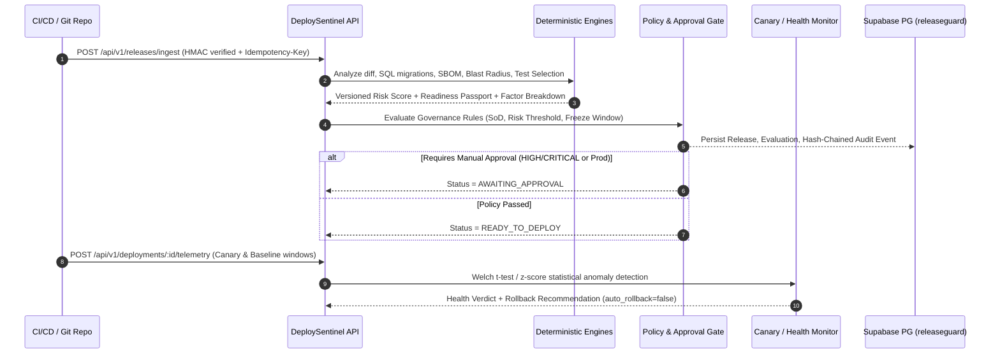

# DeploySentinel — System Architecture

**Version:** 1.0.0  
**Last Updated:** 2026-11-16  

---

## 1. Architectural Overview

DeploySentinel is architected as a modular TypeScript monorepo separating pure deterministic domain engines (`packages/engine`), shared contracts (`packages/shared`), API & orchestration control plane (`apps/api`), and the 30-screen enterprise web console (`apps/web`).

---

## 2. Deployment & Request Lifecycle

---

## 3. Multi-Tenant & Database Isolation

- **Database:** Supabase PostgreSQL 17.11 (`frxweuvcxauwntotmctw`), isolated in dedicated schema `releaseguard` (zero collision with `public` schema tables).
- **Row-Level Security (RLS):** Every tenant-owned table enforces `organization_id` scoping via PostgreSQL RLS policies (`releaseguard.current_org_id()`) and API-layer `TenantContext` middleware.
- **Immutable Audit Chain:** Every sensitive mutation computes `entry_hash = SHA256(prev_hash || org_id || actor_id || action || resource_id || canonical_payload || created_at)` enabling cryptographic tamper detection.

---

## 4. Resilience & Graceful Degradation

- **Queueing:** Uses Redis/BullMQ when `REDIS_URL` is configured; automatically falls back to PostgreSQL-backed durable job execution in single-node or sandboxed environments.
- **AI Adapter:** Defaults to deterministic template/evidence synthesis (`AI_PROVIDER=local`) with optional OpenAI/Anthropic/Ollama adapters guarded by prompt-injection sanitization, schema validation, and circuit breakers.
