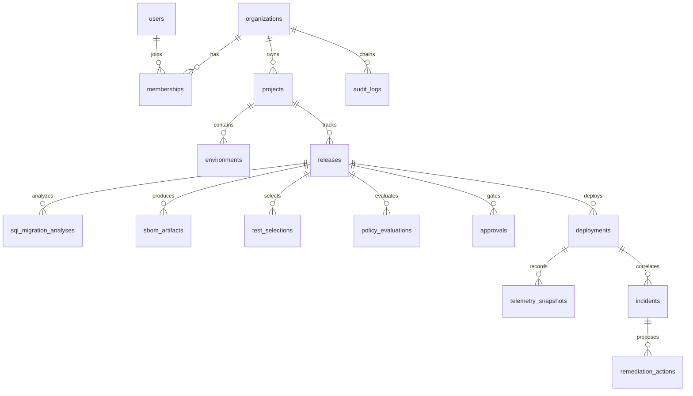

# DeploySentinel — Database Schema & Row-Level Security

DeploySentinel uses a dedicated PostgreSQL 17 schema **`releaseguard`** on Supabase (`frxweuvcxauwntotmctw`), completely isolated from `public` tables, with Row-Level Security (RLS) enabled on all 26 tenant-owned tables plus `organizations`.

## Key Safety Constraints in DDL
- `projects.auto_rollback_enabled` defaults to `false`.
- `environments.auto_rollback_enabled` defaults to `false`.
- `releases.idempotency_key` has a unique constraint per `organization_id`.
- `audit_logs` stores `prev_hash` and `entry_hash` (`SHA-256`) for cryptographic tamper detection.
- `dora_metrics_daily` stores metrics strictly by `project_id` and `metric_date` — there is no `user_id` or individual developer ranking column anywhere in DORA storage.
